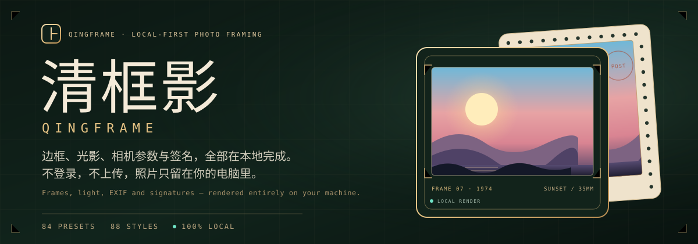
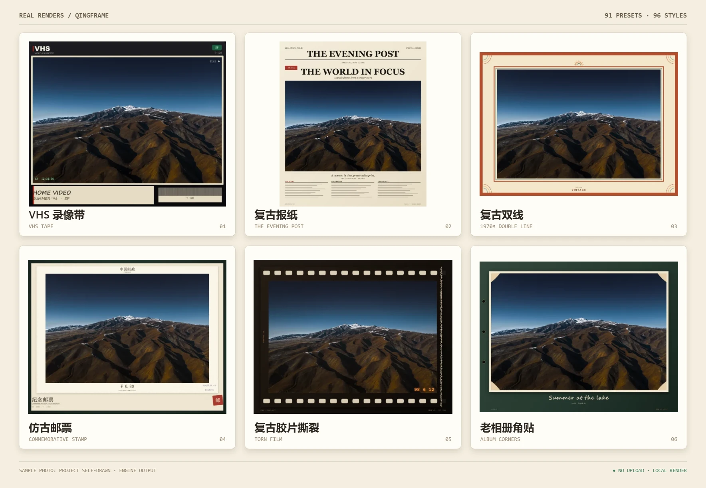
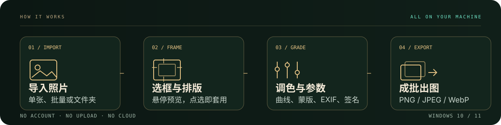

<a id="readme-top"></a>
<p align="center">
  
</p>

<p align="center">
  <strong>本地照片加框与调色工作台。</strong><br>
  给照片一副好框，给参数一个位置。
</p>

<p align="center"><sub>A local-first Windows desktop app — 91 presets and 96 frame styles, live grading, RAW developing, watermarks and batch export. No account, no uploads.</sub></p>

<p align="center">
  <a href="https://github.com/lumos-1s/Qing-Fram-Shadow/stargazers"></a>
  <a href="./LICENSE"></a>
  <a href="https://github.com/lumos-1s/Qing-Fram-Shadow/releases"></a>
  <a href="https://www.electronjs.org/"></a>
  
</p>

<details>
<summary><strong>目录 · Contents</strong></summary>

[先看效果](#screenshots) · [能做什么](#features) · [工作流程](#how-it-works) · [下载](#download) · [快速开始](#quick-start) · [最近更新](#whats-new) · [技术栈](#tech-stack) · [项目结构](#project-structure) · [开发与校验](#development) · [签名与隐私](#code-signing) · [参与贡献](#contributing) · [素材与许可](#assets-license)

</details>

---

<a id="screenshots"></a>
## 先看真实效果 · Proof

<p align="center">
  
</p>

<p align="center"><sub>真实应用界面 · 示例照片与参数为演示数据 / Real UI, demo photo and data</sub></p>

<p align="center">
  
</p>

<p align="center"><sub>六张预设均由引擎实际渲染，示例照片为项目自绘 / Six real engine renders, self-drawn sample photo</sub></p>

<a id="features"></a>
## 能做什么 · What it does

清框影把「加框 → 调色 → 写参数 → 出图」收进一个离线工作台。91 款边框、96 种风格，每一款都还能继续改：

- **边框与排版** — 杂志、拍立得、邮票、报纸、撕纸、胶片、渐变卡、3D 卡、水印与头像叠加；悬停先预览，点选即套用。
- **一句话选框（AI 导演 · 兜底入口）** — 说一句「做成旅行手账」或「给妈妈的生日卡」，模型先看一眼缩略图，再从 91 款边框里挑 4 款、写好标题与副标题，并附一句为什么选它。模型只负责「挑哪款 + 写什么字」，坐标、版式、渲染仍由引擎计算，所以最坏情况是挑错框，不会画出跑版的东西。它不在主路径上——进面板默认还是「生成 4 款」，只有不知道要什么时才点这一行小字，也不记住上次的选择。需要先在「AI 设置」里填一个兼容 OpenAI 的接口，本机跑的或云端的都行。
- **AI 破框（图像模型直出）** — 把当前照片连同一段装裱描述交给图像模型，直接生成一张「3D 破框」成片：相框立在米白纸面上，主体元素越框而出、在纸面投下同向阴影。尺寸跟着原图方向走（横图 1536×1024 / 竖图 1024×1536 / 方图 1024×1024），输入框里写的字会作为「补充要求」一起发过去，不用改代码就能调纸色、框宽、留白。回来的是位图，作为一张新照片入库（状态栏写明成片尺寸），能继续调色、加字、导出——但没有图层，改不了那几笔「溢出」。入口在「AI 造型」面板里的一枚小胶囊，一次约 30–90 秒。<br>要单独填**图像模型**（如 `gpt-image-1`、`doubao-seedream-4-0-20260415`、`qwen-image-3.0`）：对话模型出不了图，拿它去请求画图接口只会换回 404，所以留空时不会拿上面的模型名顶上，而是直接告诉你还差这一项。地址本身没有画图接口的（DeepSeek、Kimi、Anthropic）会在发请求之前就拦下来，并说清该换成什么；只有对话接口的网关，界面上也会在「AI 设置」里提前标出来。带参考图的请求先走 `/images/edits`，网关没这个接口（火山方舟、阿里百炼、硅基流动这类）就自动退到 `/images/generations` 的 `image` 字段重试，成片时会注明是改道来的。模型不保证原样保留人物细节，重要片子先用小图试。
- **调色** — 直方图、曲线、混色器、校准、蒙版、黑白与锐化，按「亮 / 颜色 / 效果」分段；色温/色调带吸管，点一下画面里的灰墙或白纸就定白平衡；按 J 开「溢出警示」，过曝的地方涂红、死黑的地方涂蓝，一眼看出该拉哪一块；一键自动调色，全程本地计算、可撤销。
- **RAW 直读** — arw / cr2 / cr3 / nef / raf / dng 等三十余种格式，先出代理图，切到该张时自动补齐全尺寸。
- **文字 · Logo · EXIF** — 自动读取相机参数，自定义签名与头像排版；文字可在画布上拖动、改字号与颜色。
- **我的调色** — 存成 Lightroom 可读的 `.xmp`，批量导入、悬停预览、编组搜索，套用到选中或全部照片。
- **批量出图** — 多图导入、逐张记忆样式、同步到选中、拼图与切图、沉浸照片墙；PNG / JPEG / WebP，最高 8192px。导出可选 sRGB / Display P3 / Adobe RGB：后两者会真的转换像素并嵌入 ICC（WebP 仍按 sRGB）。

> **English** — 91 built-in preset templates with live frame, light and logo controls; per-photo grading with curves, masks and XMP presets; an AI director that picks presets and writes the captions from one sentence; collage, grid slicing, immersive presentation and batch export up to 8192px. Everything stays local.

<a id="how-it-works"></a>
## 工作流程 · How it works

<p align="center">
  
</p>

最短路径是：导入照片 → 选一个边框 → 调色或改参数 → 导出。每张照片独立记忆自己的样式，所以给这一张调好的边框，不会覆盖下一张；要统一时再用「同步到选中」主动批量套用。

<a id="download"></a>
## 下载 · Download

**当前版本 v0.1.28** — 从 [GitHub Releases](https://github.com/lumos-1s/Qing-Fram-Shadow/releases) 下载 Windows 安装版（NSIS）或便携版。

> **English** — Grab the Windows installer or portable build from Releases. Everything is rendered on your machine; no account, no upload.

安装包由 GitHub Actions 从本仓库构建，**目前未签名**，首次运行会出现 SmartScreen「未知发布者」提示。这是未签名软件的正常行为。

<details>
<summary><a id="smart-screen"></a><strong>SmartScreen 提示「未知发布者」怎么办</strong></summary>

1. 在蓝色提示框点「更多信息 / More info」。
2. 点「仍要运行 / Run anyway」，再在 UAC 里点「是 / Yes」。
3. 想先核对文件，运行 `certutil -hashfile <安装包> SHA256`，或改用免安装的便携版。

</details>

<a id="quick-start"></a>
## 快速开始 · Quick Start

从源码运行：

```bash
npm install
npm run start:soft     # 开发启动（自动挑可用的 Electron）
npm run dist           # 打包 Windows 安装版 + 便携版
```

产物在 `dist/`。Windows 上也可以直接双击根目录 `start.bat`。开发启动优先用 `start:soft`；只有 GPU 进程崩溃时才换 `start:sw`（软件渲染，慢但兼容）。

> **English** — `npm install` → `npm run start:soft` → `npm run dist`. Artifacts land in `dist/`.

想换预设墙封面：把图片按分类名放进 `design/preset-wall-samples/`，运行 `npm run gen:wall`；只想换单张，用应用内「换封面」按钮打开 `wall-covers/` 目录放入 `<预设名>.webp` 后重启。

<a id="whats-new"></a>
## 最近更新 · What's New

### v0.1.28 · 2026-11-18

- 预设墙支持 Ctrl / ⌘ + 滚轮缩放，顶部滑块同步；以视口中心卡片为锚点，画面不飘。
- 启动页墙头去掉标题与副标题，只留品牌报头，首屏更干净。
- 清理遗留死代码，补齐视觉回归等测试覆盖。

### v0.1.27 · 2026-11-17

- 调色栏新增一键「自动」：按直方图定曝光与黑白场、校正白平衡；RAW 照片同时调好显影白平衡，可撤销。
- 界面收成暗房质感：纯色主按钮、发丝线分层、线性图标；新手引导改为三步流程卡。
- 修复背景模糊卡片圆角照片的白边。

完整变更与安装包见 [GitHub Releases](https://github.com/lumos-1s/Qing-Fram-Shadow/releases)；应用内「设置 → 关于 → 更新内容」也有离线版。

<a id="tech-stack"></a>
## 技术栈 · Tech Stack

| 层 | 技术 |
|---|---|
| 桌面壳 | Electron 45（主 / 渲染分离，`contextIsolation` + `sandbox`） |
| 渲染 | 原生 HTML / CSS / JavaScript + Canvas 2D 离屏合成 |
| RAW 解码 | LibRaw（`libraw-wasm`，主进程独立线程；LGPL-2.1 / CDDL） |
| 打包分发 | electron-builder（NSIS + 便携版） |
| 自动更新 | electron-updater + GitHub Releases |

没有前端框架，也没有后端服务；边框、光影、文字与导出都在渲染进程的 Canvas 2D 里完成。

<a id="project-structure"></a>
## 项目结构 · Project Structure

```
├─ src/main/          # Electron 主进程：窗口、菜单、文件 IPC、模板读写
├─ src/renderer/      # 渲染进程：UI 与 Canvas 2D 渲染引擎
├─ shared/presets/    # 91 款内置边框模板（JSON）
├─ shared/textures/   # 纹理素材（10）
├─ assets/readme/     # README 首图、流程图、界面截图与预设效果墙
├─ tools/             # 构建、校验与 Electron 测试辅助脚本
├─ tests/             # 单元 / 视觉回归测试
└─ start.bat          # Windows 快速启动脚本
```

<a id="development"></a>
## 开发与校验 · Development

<details>
<summary><strong>发布前自检 · Pre-release checks</strong></summary>

```bash
npm run check         # ESLint + 预设/能力表计数 + 主进程 I/O、图标、引擎不变量
npm run test:ci       # check + 全部 Electron GUI 用例
npm run release       # 未压缩目录 → verify:dist → 打安装包 → verify:pkg
```

`verify:dist` 会拦截品牌 Logo 泄漏、预设 / 纹理数量与源码不符、产物早于源码改动；`verify:pkg` 另核对安装包与 `latest.yml` 的 size / sha512。期望数量从 `shared/` 实测，不写死在脚本里。详细流程见 [RELEASE.md](./RELEASE.md)。

</details>

<a id="code-signing"></a>
## 签名与隐私 · Signing & Privacy

**Windows 产物目前未签名。** 曾向 [SignPath Foundation](https://signpath.org/) 申请开源项目免费代码签名，因项目公开可见度未达门槛而未获通过；达到条件后会重新申请。**任何称当前版本已由 SignPath 签名的说法都不成立。** 请只从本仓库 Releases 下载，并按 [`CODE_SIGNING.md`](./CODE_SIGNING.md) 核对校验值。

- 签名范围、审批与验签：[`CODE_SIGNING.md`](./CODE_SIGNING.md)
- 联网与隐私说明：[`PRIVACY.md`](./PRIVACY.md)
- 第三方素材归属：[`THIRD-PARTY-ASSETS.md`](./THIRD-PARTY-ASSETS.md)

> **English** — Builds are unsigned for now. Do not describe any current release as signed; verify checksums via `CODE_SIGNING.md`.

<a id="contributing"></a>
## 参与贡献 · Contributing

Fork → 新建分支 → 改动后跑 `npm run check`（涉及 UI 再跑对应 Electron 用例）→ 提 PR。Issue 与 PR 都欢迎。

<a id="assets-license"></a>
## 素材与许可 · Assets & License

代码采用 [MIT](./LICENSE) 许可，覆盖 `src/` 源码与 `shared/presets/` 中的原创模板；`shared/textures/` 素材权利归各自权利人所有。

- **品牌 Logo 不在仓库、也不在安装包内**：运行时只读用户数据目录，需自行用「Logo → 导入 Logo 素材包」导入。品牌名称与图形仅用于标识拍摄设备，本软件与任何品牌无授权或合作关系。
- **README 示例图**：示例照片为项目自绘合成图，界面截图与预设效果由真实应用渲染，未使用图库或用户照片。

---

<sub>关键词 / Keywords：照片加边框 · 艺术边框 · 水印 · EXIF 相机参数 · 拼图 · 九宫格切图 · 批量导出 · Electron · Canvas 2D · photo frame · watermark · collage · grid slice · batch export</sub>

<p align="center"><sub>如果清框影对你有帮助，欢迎点一个 ⭐ Star · <a href="#readme-top">回到顶部 ↑</a></sub></p>
